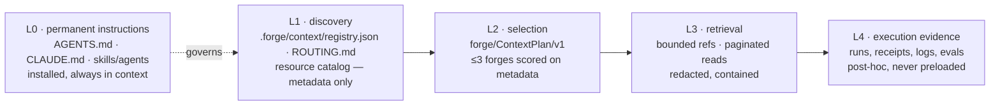

# Context Engineering — the L0–L4 model

How context moves through The Forge: what the host always sees (L0),
what the platform can *discover* (L1), what a task *selects* (L2), what
is actually *retrieved* (L3), and what the run leaves behind as
*evidence* (L4). Every level is deterministic and bounded — no LLM, no
embeddings, no silent summarization in the core.



## L0 — permanent instructions

What the host loads regardless of task: the managed instruction assets
the install writes — `AGENTS.md` / `CLAUDE.md` blocks
(`forge:ecosystem` + one `forge:<forge-id>` block per installed forge),
the regenerated `AGENT_PROTOCOL.md`, and the host directories
(`.claude/`, `.agents/`, `.devin/`, `.github/`) skills and agents.

L0 is sized by the **install profile** and component selection
([profiles.md](profiles.md)), not by any per-task budget — it is the
fixed cost of having the family installed at all. Per-forge blocks in
`AGENTS.md` are deliberately compact: identity, domains and the
capability-manifest pointer (~<500 bytes per forge). CLI/MCP/discovery
detail lives once in `AGENT_PROTOCOL.md` and in each manifest under
`.forge/context/capabilities/` — pointers, never duplicated
instruction text. Safety-critical rules (evidence-before-conclusion,
retrieved-content-is-data) stay in the shared `forge:ecosystem` block.

## L1 — discovery, metadata only

The workspace-level registry `.forge/context/` (`forge/context/v1` per
forge → `forge/context-registry/v1` + `ROUTING.md`, regenerated
deterministically — sorted keys, no timestamps) and the account registry
`~/.forge/installations/` together answer "what is installed and what
does it declare". The typed resource catalog (`theforge resources list`
/ `search`) exposes entries as metadata — id, kind, description, tags,
domain, availability, qualified ids (`<forge-id>:<resource-id>`).

L1 never reads resource bodies. Its cost grows with catalog size — the
documented bound of the model.

## L2 — selection (`forge/ContextPlan/v1`)

`theforge context plan` runs `plan_context`: term-overlap scoring of the
task against catalog metadata — deterministic, no embeddings. It picks
the best-scoring forge plus auxiliaries (`MAX_L2_FORGES = 3`) and emits
bounded L3 *references* — bodies are still not read, only sized via
`stat()` against `level3_budget` (default 8 000 bytes) and `max_l3_refs`
(12). Only resources of selected L2 forges may escalate to L3.

The plan carries **selection evidence** (additive, never breaking older
readers):

- `selection` — `selected` | `ambiguous` | `no_match`;
- `confidence` — `high` | `medium` | `low` (absent on `no_match`);
- `evidence` — matched metadata terms per forge;
- `forge_scores` — the deterministic scores;
- `alternatives` — runner-ups with the reason each was not selected;
- `disambiguation` — why the primary won, or what the tie needs.

A tie at the top is declared **`ambiguous`**: `level2_forge` is unset,
tied candidates are listed in deterministic forge-id order (never
install order), and *nothing escalates to L3* until the caller
disambiguates. Selection is merit-based — a second-installed forge wins
on score, never position.

`est_level3_bytes` is exactly that — an estimate from file sizes, not
measured bytes. A `level3_budget < 0` is rejected up front
(`ValueError`); zero is a legal empty budget.

## L3 — bounded retrieval

`theforge resources get` (`ResourceResolver.get`) serves one resource
under hard limits:

- **bounded window with a hard ceiling** — `max_bytes` (default 262 144)
  is clamped to the internal `MAX_READ_BYTES` (1 MiB) ceiling; a larger
  request is served at the ceiling and flagged `capped: true` — a caller
  cannot widen the limit by asking for more. `offset` paginates large
  files; `truncated`/`served_bytes` report the served window honestly;
- **typed rejection** — negative `max_bytes`/`offset`, non-integer or
  boolean values, and offsets beyond EOF raise
  `ResourceErrorKind.INVALID` (offset exactly at EOF is a legal empty
  window); missing, undeclared or unavailable resources fail with typed
  kinds (`NOT_INSTALLED`, `NOT_INDEXED`, `UNAVAILABLE`,
  `BLOCKED_BY_POLICY`, `PERMISSION_DENIED`, `CORRUPTED`) — never
  disguised as an empty result;
- **regular files only** — FIFOs, devices and sockets are refused
  before any read; undecodable content surfaces as `CORRUPTED`;
- **containment** — locations must resolve inside the declaring root;
  symlink escapes are refused;
- **denied content** — executables, archives and key material
  (`DENY_SUFFIXES`) are never served;
- **redaction** — content passes `security.redact` before leaving;
- **listings capped** — a directory location serves at most 500
  entries, flagged when truncated;
- **integrity** — `--integrity` hashes the whole file when it fits the
  4 MiB cap; otherwise the served window is hashed and flagged
  `sha256_scope: window`.

## L4 — execution evidence

What a completed run *leaves behind*: run dirs under `.forge/runs/`,
install receipts under `.forge/install/receipts/`, evals and logs. L4 is
post-hoc — it is read on demand for verification, debugging or audit,
and is never preloaded into a task's context. `theforge doctor` reads a
bounded slice of it (receipt statuses, ledger drift) to diagnose;
`theforge runs`/`replay` inspect it directly.

## Measuring L0–L4: `theforge context budget`

`theforge context budget` emits `theforge/ContextBudget/v1` — a bounded,
offline audit of the context surface at the workspace root:

- **per-category bytes and files** — permanent instructions, skill
  metadata vs skill bodies, agents, knowledge, rules, MCP tools,
  retrieved code, evidence, history — each marked `measured` or
  `unmeasured` (runtime-only surfaces like tool output are never
  reported as zero);
- **estimated tokens, labeled** — every token figure carries
  `kind: estimated`, the method (`utf-8 bytes / 4`) and
  `confidence: low`; nothing claims an observed tokenizer count;
- **truncation honesty** — a scan that hits its file bound reports
  `truncated` as a lower bound, not a false total.

Retrieved code (L3's footprint) is reported from the fingerprint cache
when present and stays `unmeasured` when it is not.

## Inside a run: the Context Broker

For provider executions the same model appears as `ContextPack/v1` —
references + sha256, **never file content** (ADR 0007/0015):

- **tiers** — `metadata` (workspace summary, 0 bytes, always present),
  `reference` (whole file), `excerpt` (a 1-based line range),
  `requested` (added by a provider's context request). Effective tiers =
  profile tiers ∩ what the capability declares (`context.excerpts`,
  `context.requests`) — undeclared means v1 behavior;
- **budgets** — `budget_bytes` and `max_files` come from the runtime
  profile table; over-budget and over-limit candidates are `excluded`
  with closed reasons (`budget`, `max_files`, `secret`, `outside_root`,
  `missing`, `unreadable`, `tier_not_allowed`), each carrying its
  signals;
- **dedup** — an item already delivered with the same scope in a later
  negotiation round is skipped, not re-added; identical exclusion
  entries merge their signals;
- **cache** — `FingerprintStore` reuses a sha256 only when size, mtime,
  ctime, inode, device and resolved path all match and the entry was
  recorded past a 2 s racy window; the cache lives in the user cache
  dir — never inside the analyzed workspace (a poisoned workspace cannot
  pre-seed hashes), is re-read strictly and written atomically once per
  run, and is discarded whole when its **epoch** differs — the epoch
  binds the Forge package version, the provider manifest sha256 and the
  provider trust state, so a Forge/security-rule update, a manifest
  change or a permission revocation re-fingerprints instead of trusting
  stale entries;
- **provenance** — every file item and exclusion records *why* it is
  there (`signals`, `reason`), the pack names its `producer`, and
  `Evidence.hash` is normative (sha256 of exactly the delivered bytes);
  verification-level TOCTOU re-checks downgrade drifted evidence to
  `unresolved`;
- **honest metrics** — `tier_bytes`/`used_bytes` are measured bytes;
  `tokens` is always `unknown` in the core. Host token counts are kept
  only when the provider reports them as `measured` or `estimated` —
  the `Metric` kind is explicit, never implied.

## The intentional boundary

No semantic or LLM summarization exists in the core — by invariant.
Scoring is term overlap; selection is signal-driven; retrieval is byte
windows. Where judgment is needed the system returns explicit states
(`ambiguous`, `unverified`, typed failures) instead of guessing. The
`Signals` classification axes (`platform`, `service`, `language`,
`artifact_type`) are indexing/discovery labels (`axes_index()`), never
routing inputs — the same honesty rule as the rest of the model.

## Commands

```bash
theforge context plan "tune AWS Glue PySpark job"
theforge context plan "task" --budget 16000
theforge context plan "generic iceberg task"   # tie → selection: ambiguous
theforge context budget                        # per-category bytes + labeled estimates
theforge resources list --forge spark-forge-aws
theforge resources search "glue"
theforge resources describe spark-forge-aws:kb-glue-tuning
theforge resources get spark-forge-aws:kb-glue-tuning --max-bytes 8192 --integrity
```

Related: [context-roi.md](context-roi.md) (measured ROI, advisory
budgets) · [profiles.md](profiles.md) (budget tables) ·
[ADR 0015](adr/0015-context-intelligence.md) (tiers, fingerprints,
TOCTOU) · [ADR 0061](adr/0061-forge-context-registry.md) (the
`.forge/context/` registry).
