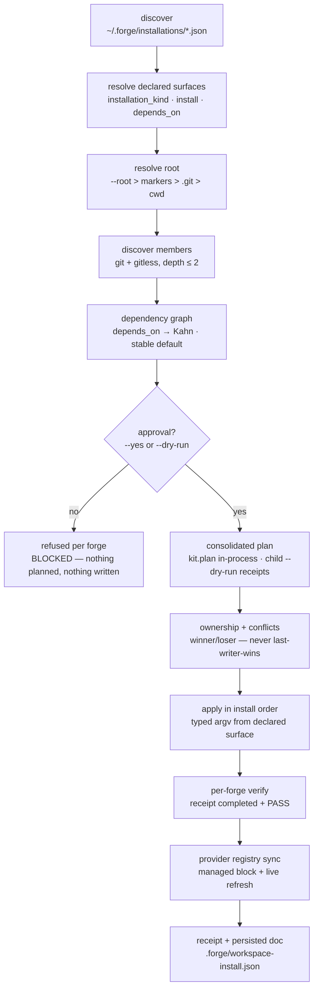

# Workspace Installation 2.1 — Architecture and Operational Guide

The consolidated workspace install pipeline (install-2.1,
[ADR 0065](../adr/0065-workspace-installation-consolidated.md)): `install
auto` plans every registered forge **before** any write, resolves
cross-forge managed-path conflicts explicitly, applies in a deterministic
order, and verifies each forge by its own `forge/InstallReceipt/v1` —
never by exit code alone. The single record of the run is
`forge/WorkspaceInstallation/v2`.

This page documents the system as it is; when it diverges from the code,
the code wins.

## Pipeline



## Stage by stage

### 1. Discover registered forges

`install auto` reads the account registry `~/.forge/installations/*.json`
— the `forge/InstallationManifest/v1` documents written by each forge's
own bootstrap. `--forge <id>` restricts the run to one registered forge;
an unknown id is `FORGE-INSTALL-NOT-INSTALLED`. An empty registry is a
BLOCKED check, not an empty success. `theforge installations list` shows
the same registry read-only.

### 2. Resolve declared capabilities

Since install-2.1 each manifest may declare its install surface
(verbatim from the forge's `forge.json`, propagated by the bootstrap):

```jsonc
{
  "installation_kind": "control-tool",      // content | service | control-tool
  "install": {
    "operations": ["plan", "apply", "status", "doctor", "repair",
                   "update", "uninstall", "auto", "mcp-verify"],
    "flags":      ["--scope", "--root", "--host", "--profile",
                   "--components", "--gateway-profile", "--yes", "--dry-run"],
    "hosts":      ["claude", "devin", "codex", "copilot"],
    "scopes":     ["project", "workspace", "user"],
    "profiles":   ["minimal", "recommended", "full"],
    "approval":   "--yes"
  },
  "depends_on": []
}
```

`installation_kind` semantics:

| kind | installs | example |
|---|---|---|
| `content` | host assets — skills, agents, markers, configs | specialist forges |
| `service` | a runtime surface hosts connect to (e.g. an MCP server) | forges exposing services |
| `control-tool` | orchestration/control-plane tooling | the-forge itself |

The kind only drives the **default install order** (control-tool →
service → content); it is not a routing or trust input. A manifest
without `install` keeps the v1 contract: the standard flag family is
assumed, exactly as before.

### 3. Resolve the root

`--root` is authoritative. For `--scope workspace` an explicit root can
never be overridden by an ancestor marker — markers
(`forge.workspace.yaml`, `forge.workspace.json`, `.forge-workspace`, or a
`pyproject.toml` carrying `[tool.forge.workspace]` /
`[tool.uv.workspace]`) are only consulted when no `--root` was given, and
they confirm the directory the walk reaches, never one above an explicit
root. Without marker or `--root`, workspace scope falls back to the VCS
root, then the cwd.

`project` scope resolves `--root` or the nearest `.git` ancestor; a
directory already carrying the forge's state dir counts as installed
even without VCS. Neither → `FORGE-INSTALL-NOT-A-REPO`.

`theforge init` writes `forge.workspace.yaml` at the workspace root —
the marker this search recognizes. It is written once (an existing
marker is never rewritten) and deleting it unmarks the directory.

### 4. Discover members (git + gitless)

Workspace scope discovers member projects under the root — directories
carrying any of the member markers: `.git`, `forge.json`,
`forge.agentic.json`, `pyproject.toml`, `package.json`. Gitless members
(copied bundles, exported worktrees, fresh scaffolds) are first-class —
`.git` is no longer required.

Discovery properties: `os.scandir` walk, `max_depth=2`, symlinks and
junctions never followed, hidden and ignored directories skipped, and
the walk never descends into a directory already recognized as a member
(its inner modules stay isolated). The root itself counts when it is a
project root.

A member already project-installed for a forge (its own `.mcp.json` key
or `<forge-id>:managed` marker block) keeps `project` precedence —
workspace assets specialize, never widen.

### 5. Dependency graph → install order

Declared `depends_on` edges get a deterministic topological order (Kahn)
over a stable base (`installation_kind` rank, then `forge_id`). Honest
degradation, never guesses:

- no forge declares dependencies → stable default order, with a
  `order_note` saying so;
- `depends_on` naming unregistered forges → ignored for ordering, noted;
- a dependency cycle → broken at the lowest-ranked forge, noted in the
  document — never silently ignored.

### 6. Consolidated plan (plan-before-apply)

The approval gate (`--yes` or `--dry-run`) precedes **all** plan
collection — without it no forge is even planned. With it, every forge's
plan is collected before any write:

- the-forge plans in-process (`kit.plan()` — pure, never writes);
- each sibling is asked for its own plan: the delegated argv is invoked
  with `--dry-run` and the child's `forge/InstallReceipt/v1` (stdout) is
  the plan evidence (120 s bound).

A forge whose plan cannot be honestly obtained — undeclared surface,
unresolvable executable, no receipt — is marked `unsupported` /
`unavailable` with the reason. Paths are never fabricated.

### 7. Ownership and cross-forge conflicts

Two forges planning the same whole-file managed path is a real conflict.
Winner/loser resolution:

- the **incumbent** wins when exactly one claimant's planned bytes
  already sit at the path (sha256 match on disk);
- otherwise the **first forge in install order** wins.

`mcp` (managed keys inside `.mcp.json`) and `marker` (managed blocks
inside user docs) are namespaced per forge — never path conflicts. The
loser's paths are excluded from its apply (`skipped`, noted as a
cross-forge conflict); after apply the resolution is recorded from the
losers' receipts. A loser that wrote anyway is named
`overwritten — plan violation` and the `cross-forge-conflicts` check
FAILs — last-writer-wins is forbidden.

The ownership vocabulary (`OWNERSHIP_POLICIES`): `forge-owned`,
`shared`, `managed-block`, `managed-key`, `user`, `foreign`. Evidence
provenance is recorded per forge (`ownership_source`): `receipt` when
the applied InstallReceipt proves the paths, `plan` when it is a dry-run
projection — the document never invents ownership.

### 8. Approval — apply defaults to No

`install apply` and `install auto` on a TTY print the plan
(`format_status_doc`: per-forge classification, winner/loser conflicts,
order notes) and ask to apply. The confirmation defaults to **No** —
writes need an explicit `y`; an empty Enter aborts with
`declined — nothing written`. Non-interactive runs require `--yes`
explicitly; `--dry-run` stays approval-free.

### 9. Apply — typed delegation argv

Sibling forges are installed by their **own** governed CLIs — the
orchestrator never writes another forge's assets itself. Argv is built
strictly from the declared surface:

- `install_command` template → resolved placeholders (`{python}`,
  `{checkout}`, `{home}`, `{install_root}`); an undeclared placeholder
  is refused;
- else `cli` → `<cli> install`;
- neither → `FORGE-INSTALL-UNSUPPORTED`, classification
  `unsupported-capability`.

`--scope`/`--root` are the request itself — always appended.
`--host`/`--profile`/`--components`/`--gateway-profile` and the approval
flag are appended only when the template did not already declare them.
When the manifest declares `install.flags`, a request flag outside the
list makes the request **unhonorable** — `E_UNSUPPORTED`, never a
silently widened argv. Every argv token is validated before exec
(non-empty, no control characters, no shell metacharacters), and
`argv[0]` must resolve before it runs.

### 10. Per-forge verify — receipt-verified success

Only a valid child `forge/InstallReceipt/v1` reporting `status:
completed` + `verification.status: PASS` counts as success — searched in
stdout first, then the newest receipt file under
`<target>/.<state>/receipts` written after the delegation started:

| child outcome | forge status | check |
|---|---|---|
| returncode ≠ 0 | `failed` | FAIL |
| rc = 0, no receipt | `unverified` | UNVERIFIED |
| receipt `completed` + `PASS` | `completed` | PASS |
| receipt `completed`/`planned` w/o PASS | `unverified` | UNVERIFIED |
| anything else | `failed` | FAIL |

A green exit code alone is **not** evidence of success.

### 11. Provider registry sync

On apply (and on dry-run) the run also syncs installed local forges into
the managed block of the user `providers.toml` and refreshes the live
registry — idempotent, manual entries preserved, only `ready` + trusted
entries routable. It is reported as its own check
(`provider-registry`); `theforge providers sync --yes` remains the
explicit repair path.

### 12. Receipt and persisted document

The run emits `forge/InstallReceipt/v1` (`operation: install-auto`)
carrying the consolidated document under `installation`. At workspace
scope the doc is also persisted into `.forge/workspace-install.json` —
the `forge/WorkspaceInstall/v1` manifest keeps its append-only
`projects[]` (merged by `(path, forge_id)`, `created_at` preserved
across runs) and gains the `installation` block. Extends, never
replaces, v1 semantics.

## `forge/WorkspaceInstallation/v2`

Plan view, apply record and ownership inventory in one shape — see the
[JSON schema](../../schemas/WorkspaceInstallation.schema.json) and the
[contract doc](../portable-installation/contract-v1.md):

| field | content |
|---|---|
| `workspace_root`, `scope` | resolved target + scope of the run |
| `order`, `order_note` | install order + honest ordering notes |
| `forges[]` | per forge: identity, `installation_kind`, declared `surface`, `depends_on`, `resources[]`, `owned_paths`, `ownership` + `ownership_source`, `security`, `classification` + detail, `verification` |
| `conflicts[]` | `path`, `claimants`, `winner`, `loser`, `resolution`, `detail` |
| `members[]` | discovered member paths (workspace scope) |
| `verification` | aggregate: FAIL if any forge FAILs; PASS iff all PASS/NOT_APPLICABLE; else UNVERIFIED |

## Closed vocabularies

### Plan classification (per forge)

| classification | meaning |
|---|---|
| `new` | no prior install evidence; managed paths would be created |
| `updated` | installed; ≥1 managed path would change |
| `reused` | installed and converged (or install evidence at target) |
| `preserved` | not delegated this run — existing install untouched |
| `conflict` | loses ≥1 managed path to another forge |
| `unsupported-capability` | no honest delegation/plan surface for the request |

`null` classification is legal and means *honestly unclassified* — the
`classification_detail` always says why.

### Verification states

`PASS`, `FAIL`, `BLOCKED`, `UNVERIFIED`, `NOT_APPLICABLE` — the same
closed set install checks emit. Homologation surfaces (E2E, federation)
use the wider closed `Verdict` taxonomy (`contracts.verdicts`): `PASS`,
`FAIL`, `BLOCKED`, `SKIPPED`, `NOT_APPLICABLE`, `UNVERIFIED`, `ERROR` —
`ACCEPTANCE` is the single table allowed to decide what a verdict means
for a gate (`PASS` → success; `FAIL`/`ERROR` → blocking; the rest →
unverified). A verdict outside the set is a contract violation, not a
warning.

## Commands

```bash
theforge setup                              # guided family onboarding (TTY)
theforge setup --scope workspace --dry-run  # consolidated plan, nothing written
theforge install auto --scope workspace --yes
theforge install auto --forge spark-forge-aws --yes
theforge install auto --scope workspace --member sub/repo --yes
theforge install apply --scope project --yes
theforge install status
theforge install doctor
theforge install uninstall --scope workspace
theforge install uninstall --scope workspace --purge
theforge installations list
```

`--member` (repeatable, workspace scope only) additionally delegates a
project-scope install into the named member — the same governed argv
path. `--host`, `--profile`, `--components`, `--gateway-profile` are
propagated to every registered forge **that declares them**.

## Selective uninstall

`install uninstall` removes only what the ledger declares managed:

- managed files whose sha256 still matches are deleted; a file you
  modified afterwards is **kept** (reported as `kept`);
- marker blocks are excised from your docs — the file itself survives;
- the `.mcp.json` managed key is unset while sibling servers and user
  metadata are preserved;
- directories that empty are pruned; yours stay;
- `--purge` additionally removes the `.forge/install` state;
- `--dry-run` plans the same selection without writing.

Uninstall is per forge — run it through each forge's own CLI; the
orchestrator does not guess what a sibling owns.

## Troubleshooting quick links

| symptom | where |
|---|---|
| approval gate / `FORGE-INSTALL-PLAN-NOT-APPROVED` | [troubleshooting.md](troubleshooting.md) |
| `FORGE-INSTALL-UNSUPPORTED` — surface lacks a requested flag | this page §9; declare it in `forge.json` `install.flags` or drop the request |
| forge `unverified` after apply | its CLI returned no `forge/InstallReceipt/v1` — check the child receipt, not just rc |
| `FORGE-INSTALL-NOT-A-REPO` | project scope needs `.git` or `--root` |
| workspace resolved the wrong root | pass `--root` — explicit wins over ancestor markers |
| drift / managed files changed | [update-and-repair.md](update-and-repair.md) |
| removing an install | [uninstall.md](uninstall.md) |

Canonical error codes: [errors.md](../errors.md).

## Migration notes from v1

Short version: `install auto` used to apply forge-by-forge and trust
exit codes. Now it plans everything first, resolves conflicts
explicitly, and trusts only receipts. The user-facing deltas — the
default-No confirmation, gitless members, `--root` precedence, the
`forge.workspace.yaml` marker, and what forges should declare — are in
[migration-2.1.md](migration-2.1.md).
